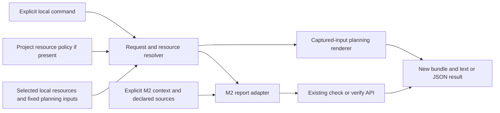

# KDX11 task-time content design

| Document information | Value |
| --- | --- |
| Document ID | KDX11-TT-DESIGN |
| Revision / date | 0.1 / 2026-11-14 |
| Applicability | Karakana local task preparation and explicit narrative checking after accepted TT01-TT12 |
| Canonical source / baseline | This file; executable baseline `a9691745c99f907e6e5574ae2dd5d135299e3b86` |
| Decision status | DD01-DD12 revision0.1 accepted by the owner on2026-11-14; implementation remains separate |

## Boundary and governing references

Design a small explicit preparation/reporting workflow, with no new automatic
protocol-stage gate. Existing [TT01-TT12 requirements](2026-11-14-task-time-content-requirements.md),
[accepted checker design](../skills/engineering-artifact-catalogue/CONTENT-PROFILE-DESIGN-2026-11-13.md)
and [M2 results](../skills/engineering-artifact-catalogue/CONTENT-PROFILE-IMPLEMENTATION-PLAN-2026-11-14.md)
govern. No existing checker requirement or architecture is reopened.

Excluded: live execution, source application, approval transitions, new document
packs, native/P02 adapters, exports, automatic skill selection and deployment.
Existing skills/templates already support actual project-document drafting;
completing this automation is not a prerequisite to drafting ent-meal documents.
The owner's question about remaining work and instruction to finish select
completion of this design round, not unreviewed code or a new ent-meal task.

Tailored standards remain ISO/IEC/IEEE29148:2018 for requirement traceability,
ISO/IEC/IEEE42010:2022 for concern-driven design, ISO/IEC25010:2023 for applicable
quality concerns, and ISO/IEC/IEEE15289:2019 for information-item content. Their
public-source/evidence limits in the accepted requirements carry forward; no
new obligation, clause-level assessment or certification is asserted.

Use the [design guide](../../skills/engineering-design-records/references/system-design-template-guide.md),
[document map](../../skills/engineering-documentation-conventions/references/document-map.md)
and [UX copy conventions](../../skills/ux-writing/references/interface-copy-patterns.md).
Existing CLI/W3C research is reused. New interface research on2026-11-14 checked
[Typer output guidance](https://typer.tiangolo.com/tutorial/printing/): use literal
plain output, keep diagnostics separate from machine stdout, and avoid interpreting
untrusted text as terminal markup. [Python package-resource documentation](https://docs.python.org/3/library/importlib.resources.html)
supports package-owned profile reading; it does not make arbitrary checkout assets
installed resources. This design adds no dependency or new package-data obligation.

## Actors, structure and authority

| Actor / concern | Responsibility / success signal |
| --- | --- |
| Task author | Explicitly identifies action, artifact, audience and scope; sees effective selected resources and a prepared prompt |
| Document reviewer | Sees scoped completeness, freshness, gaps and unassessed concerns without inferred acceptance |
| Automation consumer | Parses one versioned result and interprets typed outcome/assessment, never process code alone |
| Project owner | Owns governing conventions and scoped design/product decisions; no command advances that authority |
| Local operating system | Supplies files under the caller's declared root; OS access remains necessary, not a grant to fetch or execute linked content |



The editable Mermaid source is this component/data-flow view. It addresses
author/consumer scope and trust concerns; there is no server, database, queue,
background controller or Viewflow process. The Viewflow skill's state/authority
separation and negative-transition discipline were checked; its Django UI and
migration machinery do not apply to this repository's local CLI.

Project/root/request → resolver: literal selections and identity.
Resolver → renderer: captured, bounded inputs, not permission to follow links.
Resolver → M2: existing explicit context path and unchanged profile contracts.
Renderer/M2 → writer: proposed prompt/report plus actual outcome; never source edits.
Output → owner: review evidence, not acceptance or execution authority.

## Design decisions and alternatives

All choices below were reviewed together for revision0.1 and accepted without
revisions. Each records a real
alternative and consequence; no current implementation is claimed.

| ID | Choice and rationale | Alternative / consequence | Requirements |
| --- | --- | --- | --- |
| DD01 | Add `karakana docs content prepare`, `check`, `verify`; keep task preparation separate from checking and live execution. | Adding flags to `plan`/`codex run` is familiar, but couples new result/output rules to overwrite/live/handoff behavior. Separate commands add a discoverable surface while retaining those contracts. | TT01, TT05, TT12 |
| DD02 | Use one strict, versioned JSON request plus a fixed optional local resource policy. Project defaults require explicit per-request opt-in; record effective origin and displaced choices. | Many CLI flags duplicate multi-document context and obscure precedence. Free-form Markdown cannot support deterministic conflict checks; its instructions still require substantive review. | TT01, TT02 |
| DD03 | Keep the existing resource map as guidance; encode a small recommendation inventory for the two shipped types, verified by tests against actual paths/owners. Recommendations never select content. | Runtime Markdown catalogue crawling is brittle and expands context implicitly. The inventory adds a small consistency obligation, not a new editable document master. | TT01, TT03, TT04 |
| DD04 | Resolve only explicit resources/dependencies and fixed mandatory planning inputs through captured guarded reads. Extract a shared pure planning renderer from the current composer. | Calling the current writer or rereading unchecked files can overwrite output or render bytes different from provenance. Capturing costs bounded memory and a small compatibility-preserving refactor. | TT03, TT07, TT12 |
| DD05 | Profile/version choices come from the existing explicit M2 context; no duplicate request override. Support M2's current two narrative profiles/context0.1/0.2 unchanged. | Duplicating profile or source identity in the new request creates conflicting authorities. Unsupported sources remain visible, with no format conversion. | TT02, TT04, TT05 |
| DD06 | Return a versioned task result containing the unchanged M2 assessment, separate operation/selection/freshness information and located diagnostics. | Returning only M2 `.ok` or an exit code loses scope and authority states. A wrapper costs validation but does not alter report0.2. | TT06, TT08, TT09, TT11 |
| DD07 | Save new bundles with separate bare M2 report and task result; verify both via recomputation, not timestamps or cached digests. | Embedding only a report in the new envelope cannot be passed directly to existing `verify_report`; trusting metadata would miss resource or assessment edits. Two generated representations require equality checks. | TT07, TT11, TT12 |
| DD08 | Keep source, task labels and authority distinct. Carry scoped gaps/actual declared claims; do not infer truth, acceptance or global holds. | One ready/accepted badge is shorter but misrepresents complete-with-gaps and unrelated held evidence. | TT06, TT08, TT09 |
| DD09 | Plain, line-oriented summary first, explicit scope/status, located correction, all findings in deterministic order; clean JSON on stdout. | Rich tables/color-only cues are less portable and may interpret source text. No interactive wizard or new presentation dependency is justified. | TT10, TT11 |
| DD10 | Exit0 for successful preparation or mechanically complete/current checks, even with warnings/gaps; exit2 for operation refusal, incomplete/unsupported checks or stale verification. Domain fields remain necessary. | Exit0 for blocked reporting repeats the KDX10 hazard. Retrofitting all existing CLI exits would exceed this slice; legacy commands remain unchanged. | TT06, TT11, TT12 |
| DD11 | Lazy-load content checking and keep authoring resources checkout-local. Missing assets/dependency produces an explicit scoped refusal, without download/install. | Packaging the full skill catalogue or fetching assets would expand release, trust and distribution scope. Bare-wheel M2 support remains intact. | TT03, TT04, TT12 |
| DD12 | Deliver resolver/preparation first, then M2 reporting/verification integration as separate bounded milestones after accepted design and a reviewed plan. | One large slice entangles prompt compatibility and saved-report integrity. A preparation-only first slice is useful but must explicitly report checking not assessed. | TT01-TT12 |

## Commands and request contract

Proposed command signatures, not currently implemented commands:

```text
karakana docs content prepare --request PATH [--root DIR] [--format text|json] [--output DIR]
karakana docs content check   --request PATH [--root DIR] [--format text|json] [--output DIR]
karakana docs content verify  --request PATH --bundle DIR [--root DIR] [--format text|json] [--output DIR]
```

Root defaults to the current directory and is resolved once. All other paths are
root-relative and guarded, including requested bundle/output paths. There are no
`--live`, execution, overwrite, force, fetch or automatic-context options. Text is
the default; JSON affects stdout, not saved bundle format. Request is required;
missing CLI options are syntax errors on stderr, exit2 with empty stdout.

Strict request0.1 fields:

| Field | Contract |
| --- | --- |
| `request_version`, `project`, `skill` | Required; version `0.1`; project/skill simple non-traversing identifiers. Project names one local memory namespace, never a sibling-project discovery request. |
| `task` | Required object with nonempty `id`, `action`, `text`, `audience`, `scope`, `revision`, `artifact_types`. Action is `inquiry`, `analysis`, `review`, `author`, `revise`, `plan` or `mechanical_fix`. Types are unique literal labels, up to32; empty is valid for tasks without a document. |
| `resources` | Required array, possibly empty, of `{artifact_type, role, path, revision}`. Roles: `guide`, `template`, `example`, `reference`; guide/template/example unique per type, references unique per physical source. Entries must match declared task types. All dependency references are explicit entries; links inside a file are not declarations. |
| `use_project_defaults` | Required boolean, defaulting is not inferred. False means no overridable default resource is selected; true explicitly opts into applicable defaults. |
| `context` | Required nullable root-relative path. Null is valid for preparation; check/verify require an existing context. Context owns profile IDs/versions, document keys/baselines, source paths and mappings. |

Unknown/duplicate keys, invalid versions, unexpected types, control characters or
ambiguous resource slots refuse. Task text is at most32768 characters; other label
fields at most2048. Content-bearing labels are literal data, not templates or shell
arguments. Names/actions are supplied explicitly rather than guessed from task text.
Wrong action/type may be a substantive review issue; the tool cannot prove intent.

Illustrative future preparation request for this kind of task, not an executed run:

```json
{
  "request_version": "0.1",
  "project": "karakana",
  "skill": "engineering-design-records",
  "task": {
    "id": "KDX11-design",
    "action": "author",
    "text": "Describe explicit resource selection and result reporting.",
    "audience": "Karakana maintainers",
    "scope": "KDX11 task preparation and local narrative checks",
    "revision": "0.1",
    "artifact_types": ["system-design"]
  },
  "resources": [
    {"artifact_type": "system-design", "role": "guide", "path": "skills/engineering-design-records/references/system-design-template-guide.md", "revision": "0.1"},
    {"artifact_type": "system-design", "role": "template", "path": "skills/engineering-design-records/assets/system-design-template.md", "revision": "0.1"}
  ],
  "use_project_defaults": false,
  "context": null
}
```

Empty resources produce `not_selected`, bounded recommendations and an ordinary
prepared planning prompt; no guide/template is inserted and checking is not assessed.
Inquiries and mechanical fixes gain no pack requirement merely from keywords.
For an unknown document type, show no invented clean pack/profile. Authors may
explicitly select relevant local guidance as a reference; a nonexistent check
profile is still unsupported. Primary selected skill and resource-owning skill
are recorded separately; selecting a template does not silently switch skills.

### Project selection and precedence

For these opt-in commands only, inspect the single optional fixed path
`docs/content-policy.json`. Absence means no machine resource defaults/locks.
This design neither creates that file nor changes existing commands' behavior.
Policy0.1 has exact fields `policy_version`, `project`, `bindings`; bindings are
`{artifact_type, role, path, revision, mode}`, with mode `default` or `locked`.
At most64 bindings; one per type/role, no duplicate/contradictory slots. Only
guide/template/example slots can be policy bindings; references stay explicit.
Wrong project, malformed policy or guarded-path failure blocks this operation.

Apply task selection first, then applicable defaults only when opted in. Catalogue
recommendations and skill links are guidance, never effective selections. A task
override of a default records the replaced value, new value and origin; a locked
binding requires an identical effective selection. Missing or conflicting locked
selection holds that resource operation with a specific correction, never a silent
override or implicit grant. No override flag bypasses locks.

AGENTS/KARAKANA and other higher-priority instructions still govern. Capture their
applicable local content for preparation and record instruction review as required.
A policy file represents declared resource constraints; it does not mechanically
prove agreement with arbitrary prose instructions or create approval authority.
Conflict identified by substantive review must be resolved, not hidden by a
schema pass. Project adoption/change of a policy uses its ordinary review authority.

## Captured inputs and preparation

Use a new `karakana/document_tasks/` package, with strict schemas, resolver,
preparation and result/bundle adapter modules; CLI functions remain thin. Recommendation
inventory names only known resource paths/owning skills and pack versions. Custom
local guide/template choices are permitted within constraints; their declared
revision is a label, not automatically verified source metadata. Report actual
bytes/hash and whether the revision came from the inventory or the caller.

Preparation captures the request, optional policy, selected resources and the
fixed planning inputs: applicable AGENTS/KARAKANA, selected SKILL.md, existing
planner prompt template when present, and exact required global/project memory
files from Ubongo's current lists. Missing required project memory or selected
skill refuses; existing optional-file fallback semantics remain explicit.
Unselected projects, catalogue entries, examples and linked URLs are not read.

Extract `PlanningInputs` and a pure `render_planning_prompt(inputs)` from the
current composer. Legacy `compose_planning_prompt` keeps its signature/default
loading/output and delegates rendering, preserving byte-equivalent prompts.
The new preparation builder uses guarded captured bytes and the existing skill
Markdown parser/schema; factor the metadata-to-Skill construction into one shared
pure helper rather than duplicate interpretation. It never calls the legacy writer.
Append selected content in literal, length-delimited sections with path, role,
revision basis and hash; label examples synthetic and not governing facts. Framing
cannot guarantee later model obedience; the operation itself executes no content.

Guard every read using the existing root/credential path restrictions, UTF-8
decoding, raw hashes and physical resolved-path identity. Reject secret suffixes,
outside-root/symlink escapes, ambiguous physical roles and changes before output.
Do not print rejected sensitive paths or source snippets in diagnostics. Each
captured input set retains M2's existing bounds:32 physical files,2MB per file,
16MB total,128KB per JSON configuration. Preparation fails with a specific limit
message, never trims content silently. Check/verify use a separate M2 input set
with its unchanged32-file/16MB limits; combined work is bounded by64 files/32MB.
Repeated roles for the same permitted physical input share one captured byte record.

The new commands do not implicitly load/refresh a handoff or activate a skillpack.
The generated planning prompt is the output; giving it to a model is a separately
authorised action. Direct `plan`, `codex run`, hooks and protocols remain compatible.
Checkout-local authoring assets are required when selected; installed package code
does not imply those assets exist. Check-only use with no authoring resources can
use the packaged M2 profiles and does not require a complete planning memory tree.

## Checking, results and freshness

`prepare` validates task/selection and, when present, context declarations only;
it does not load source documents, invoke the parser or assess completeness.
Missing future draft files therefore do not prevent preparation. `check` and
`verify` require context and declared source files. The new request cannot override
document IDs/revisions/canonical authority or namespace from the existing sources.
Task/project labels and context namespace are separately displayed, not inferred
equal; neutral synthetic example context cannot become accepted project evidence.
Multi-document contexts retain existing M2 coverage/mappings/links/gap rules.
Every context document/profile type must be declared in task artifact_types; a
mismatch refuses rather than silently narrowing the context. Check all declared
M2 documents and retain every returned document/result; request labels cannot
filter an inconvenient finding out of coverage.

Call `check_content(root, context_path)` directly and preserve its report0.2 data.
Validate the supported producer version, required shapes/types, completeness,
review/readiness/acceptance invariants and consistency of findings with outcome;
do not trust `.ok` alone. Unknown, malformed or conflicting producer results refuse.
There is no new executor/import adapter for requirements/patch CLIs. If their
exit0 `blocked`/`not_ready` payload is supplied as a content result, reject it as
unsupported producer data and retain the typed state in a bounded diagnostic;
never translate it into completeness or acceptance. Future adapters need their
own explicit producer contract. Do not launch subprocesses to harvest these reports.

Task result0.1 has these exact top-level fields:

| Field | Meaning |
| --- | --- |
| `result_version`, `operation`, `outcome` | Version `0.1`; prepare/check/verify; `prepared`, `checked`, `verified`, `blocked`, `unsupported`, `failed`, `stale_or_mismatched`. Outcome describes this operation, not product readiness. |
| `task` | Normalized request project/skill/task identity and revision; caller labels remain distinct from actual document metadata. Null if request could not be decoded. |
| `selection` | `state` selected/not_selected/blocked/unsupported, effective entries with origin/owning skill/revision basis/hash, displaced defaults, bounded recommendations. |
| `content_report` | Null when no content check ran; otherwise exact M2 report0.2, including documents/findings/coverage/unassessed scope/gaps/readiness/acceptance. No renamed or flattened authority fields. |
| `freshness` | `inputs` current/unresolved; `saved_bundle` not_assessed/current/stale_or_mismatched. A current-run check is not saved-report verification. |
| `diagnostics` | Deterministically ordered entries with code, severity, safe relative location/JSON pointer where known, message, supported next action and optional bounded producer state. |
| `manifest` | Request/policy/resource/fixed-input paths, physical targets, raw hashes, declared identity, wrapper version/code fingerprint; M2's independent source/profile/checker/parser manifest stays in content_report. |
| `run` | Run ID, timezone-aware generation time and output bundle path. Volatile metadata, never approval or authenticity evidence. |

The wrapper fingerprint covers its package modules, CLI adapter, shared planner/
skill/memory rendering helpers, lifecycle prompt and deterministic router code
used in preparation. No provider call is made. Record absent optional files and
resolved targets as well as present bytes; all input-origin changes are visible.

There is no aggregate product-ready or accepted boolean. No-check results render
completeness/readiness/acceptance as not assessed without inventing a report.
For actual assessments use M2's exact values; complete-with-gaps remains review
required and unresolved for affected scope. Missing gap details remain unknown or
existing M2 errors, never invented resolvers. External evidence URI declarations
retain M2's unassessed authenticity/remote-byte limits.

### New bundles and saved verification

Default output is a unique `.karakana/document-tasks/<run-id>/` under the root;
an explicit output must also be a fresh permitted directory under `.karakana/`.
Reserve the new directory exclusively. Successful preparation writes `prompt.md`
and `result.json`; assessment writes `result.json` and bare `content-report.json`.
Refusals may save only their diagnostic result. No source, policy or context is
rewritten. Use guarded new-only writes and publish success only after all files
are written/rechecked. A partial I/O failure is a failure, not a complete bundle;
retain nonempty outputs as incomplete evidence, never overwrite or delete them.
Saved JSON reports/results must each fit the existing2MB report-read limit or
refuse with a limit diagnostic; stdout must not claim a reusable saved result.

`verify` takes the explicit current request and saved bundle, not a cached prompt
as executable input. It supports check bundles and successful verification bundles;
prepare-only, incomplete-write and foreign/version-mismatched bundles refuse.
Read both saved JSON files with strict bounded decoding. Verify their M2 assessment
copies are equal, and call existing `verify_report` on the bare M2 report. Independently
re-resolve the current selection/request/policy and compare wrapper manifests and
all deterministic result fields to recomputation. Changes in selected resource,
request scope/revision, policy, source/evidence, profile/parser/checker or wrapper
code make the bundle stale/mismatched. An absent policy becoming present also
changes the manifest; optional fixed-input presence is part of provenance.

Validate run metadata types/timezones and output-root constraints, but do not
compare generation times/run IDs/new output paths as semantic fields. For a saved
check bundle recompute check-derived fields; for a saved successful verification
bundle recompute its verified-derived fields. Normalize only the documented run
metadata and M2 generation/verification metadata according to its existing rules;
all selection, diagnostics, coverage and assessment fields remain compared.
A changed saved acceptance/outcome is not excused by an equal digest. Preserve
M2's own verification result when wrapper selection is stale: raw content may still
match while the whole task bundle is refused. No timestamp, self-consistent hash
or matching recomputation proves who authored evidence or when an approval occurred.

New verification always writes a new result bundle when output succeeds; never
updates the saved one. Recheck captured inputs, physical targets, profiles and code
before publication. This is current local consistency, not a filesystem transaction
or adversarial concurrent-write/authenticity guarantee.

## Runtime, failure and UX matrix

| Scenario | Actual domain information / copy | Exit / action |
| --- | --- | --- |
| Selected guide/template prepared | `prepared`; content_report null; “Task prepared. Content was not checked.” Show scope/resources and prompt path. |0; author may review/use prompt under separate authority |
| No resource selection | Prepared prompt, selection not_selected, recommendations explicitly unselected |0; select resources only if relevant |
| Missing/conflicting locked selection or invalid request | blocked, no selected prompt/check; precise field/slot and available correction |2; resolve only this operation; independent tasks/legacy preparation remain available |
| Check requested without context/source | blocked/failed, no completeness pass; “Content was not checked. Select a check context for this document.” |2; select declared existing inputs |
| Complete with warnings/gaps | checked, M2 complete, actual warnings/gaps/readiness and acceptance not_assessed retained |0; substantive review still required, scoped unresolved effects visible |
| Incomplete content | failed, M2 incomplete and located findings; no approval transition |2; correct reported source/context issue |
| Unsupported format/profile/parser | unsupported, supported boundary named, no conversion or installation attempted |2; select supported inputs or retain manual/native review |
| Saved bundle current, M2 complete | verified, whole-bundle current; review remains required |0; matching bytes do not establish acceptance |
| Saved incomplete assessment still matches | failed, freshness may be current but completeness remains incomplete |2; current does not mean complete |
| Content current, selected guide/policy/scope/code changed | whole-bundle stale_or_mismatched while raw M2 verification is retained |2; run check again with current request into a new bundle |
| Invalid producer / exit0 blocked or not_ready input | unsupported/failed with typed contradictory state retained; no success inference |2; supply supported producer data, not a process-success claim |
| Existing/unsafe output, changed input or partial write | failed, source/old bundle preserved; no success label |2; select a permitted fresh output or rerun after inputs settle |

Text begins with task/document scope and outcome, followed by selected resource
summary, actual completeness/freshness/readiness/acceptance and unresolved count,
then every located finding and applicable correction. No color/icon is required;
no wide table, animation, hidden truncation or unsupported retry/conversion action.
Escape control/terminal sequences and render literal text without Rich markup.
JSON stdout is one result object and newline; logs/usage errors go to stderr with
safe messages, no banners or tracebacks mixed into JSON. Runtime failures after a
valid invocation still produce a failure result where the input can be represented.

Example state copy, not an observed new-command result:

```text
KDX11 / selected documents — content complete; saved bundle not assessed.
Review required. Readiness unresolved; acceptance not assessed.
2 source gap entries remain. Review their declared scopes and next actions.
```

No request timeout, performance percentile or Windows qualification is invented.
Bounded reads, deterministic ordering and equivalent semantic results for equal
inputs are measurable requirements. No persistent cache/controller is added.

## Dynamics, leverage points and backfire risks

| Dynamic / leverage point | Risk and response |
| --- | --- |
| Authors repeat selection work; explicit defaults can reduce it | Silent defaults can load irrelevant material. Require opt-in, show origins/overrides and enforce declared locks without inventing approval. |
| Fast mechanical feedback encourages repeated checks | Green results can be mistaken for acceptance. Preserve separate states and unchanged owner authority on every result. |
| Time between preparation, edit and check changes context | Saved passes can drift. Recompute bytes, identities and assessments; no automatic cache reuse. |
| Copying examples accelerates authoring | Synthetic facts can leak into real documents. Examples are selected/labeled, not governing baselines; substantive review remains necessary. |
| CLI JSON feeds later automation | Exit0 and missing fields can produce false progress. Validate producer contract and typed states; no automatic stage transition. |
| Project holds accumulate | Global holds can freeze unrelated work. Carry affected scopes/resolver/action and keep independent drafting available. |

There is no asynchronous queue or scheduler loop to qualify. Feedback is local
command output; the consequential delay is between source/decision changes and
subsequent review. The chosen reversible levers are explicit information flow,
bounded resource rules and freshness/state clarity, rather than an autonomous gate.

## Traceability and source-alignment challenge

Planned checks below are not passed integration tests. Each TT maps to matching
A criteria in the accepted requirements.

| Requirement / criterion | Design coverage | Required implementation evidence |
| --- | --- | --- |
| TT01 / A01 | DD01-DD03, explicit actions/types and unselected recommendations | Actual prepare cases across author/review/inquiry/fix and project boundaries |
| TT02 / A02 | DD02/DD05, task/default/lock precedence and single context authority | Overrides, opt-in false, malformed/contradictory policy and ambiguous selections |
| TT03 / A03 | DD03-DD04/DD11, bounded captures, no recursive dependencies | Read/network/execution spies, traversal/secret/symlink and limits cases |
| TT04 / A04 | DD05/DD11, unchanged profile/format/dependency support | Two profiles/context versions, actual frontmatter, context0.1 links and parser-absent controls |
| TT05 / A05 | DD01/DD05, separate prepare versus explicit check | Preparation no-check spy, missing context/source, actual supported M2 call |
| TT06 / A06 | DD06/DD08/DD10, typed reports and producer refusal | Complete-with-gaps, malformed/missing results, exit0 blocked/not_ready controls |
| TT07 / A07 | DD04/DD07, captured provenance and two-layer recomputation | Source/context/resource/policy/profile/parser/code/symlink/tamper changes; presence changes; equivalent semantic ordering |
| TT08 / A08 | DD06/DD08, raw M2 scoped gaps and unknowns | Affected versus unrelated scope, missing details, declared resolver/action preservation |
| TT09 / A09 | DD08, no automatic authority transition | No owner evidence, changed accepted revision, no apply/merge/live side effects |
| TT10 / A10 | DD09, summary-first literal terminal output | Actual text at narrow width, no color/markup, all findings and supported correction |
| TT11 / A11 | DD06-DD07/DD09-DD10, clean JSON and exit/state matrix | Subprocess parsed JSON, raw report unchanged, all exit/freshness/coverage combinations |
| TT12 / A12 | DD01/DD04/DD07/DD11, isolated paths and shared pure renderer | Byte-equivalent legacy prompt tests, old CLI/P02 controls, new-only writes/partial failures and optional dependency tests |

| Challenged claim | Inspected producer → consumer / contrary state | Resolution |
| --- | --- | --- |
| Current writers satisfy new output safety | planner `write_planning_prompt` and Codex writer use write_text; isolated actual probe overwrote first with second | DD01/DD04/DD07 never call those writers; legacy behavior remains compatible |
| Selecting resources means checking finished documents | compose_planning_prompt/SkillLoader load a selected skill, no recursive guide/check | DD02-DD05 add explicit captured resources; prepare leaves checking not assessed |
| Bare installed wheel supplies authoring packs | pyproject package-data only includes content_profiles JSON; skills paths are outside karakana package | DD11 declares missing checkout assets rather than fetching/pretending availability |
| One `.ok` flag safely represents readiness | M2 ContentReport.ok only tests completeness; actual two-profile probe complete/current yet unresolved/not_assessed | DD06/DD08/DD10 preserve actual fields and domain validation |
| Existing verify can validate a wrapper envelope | verify_report requires bare report0.2 and recomputes persisted assessments; actual changed acceptance was refused | DD07 supplies bare report and separately verifies selection/result fields |
| A structural protocol pass settles owner design acceptance | protocols/checks validates presence/research structure; readiness derives from declared outcome | This record stays decision_required; owner acceptance remains explicit |

## Delivery slices, operations and review decision

After design acceptance, a separate bounded plan must name exact files, examples,
tests/evals and prerequisite gates. Proposed sequence: **S1** request/policy/resource
resolution, guarded captures, pure renderer compatibility and `prepare`; **S2**
M2 adapter, result/bundle contracts, check/verify/freshness and full negative matrix.
Each is independently reviewable and must be validated/accepted/squash merged before
the next milestone under the existing process. S1 must not claim S2 support.

Implementation inspection order: accepted TT and this design; `karakana/cli.py`,
`karakana/agents/planner.py`, `karakana/skills/loader.py`, Ubongo required-file lists,
M2 loader/schema/report/check/verify and new-only writer; actual planner/loader/CLI,
documentation/M2/protocol tests and package data. Keep new behavior in
`karakana/document_tasks/`; reuse existing helpers/contracts rather than modify
P02, model routing or protocol-stage policy. Add non-synthetic positive/negative
integration tests with temporary roots and deterministic fixtures, selected resource
inventory consistency tests and instruction/resource-map updates in the delivered
slice. Do not use the real checkout's .karakana for harness-writing tests.

Verification sequence: focused boundary cases; exact request/result examples;
legacy prompt byte equality; CLI JSON/text/exit matrix; source/output byte protection;
optional parser and installed-package context-only support; required full regression
and eval gate after code; exact PR-head checks and postmerge release verification.
Run the implementation trace's own pre-implementation artifact gate before code.
No new dependency/migration is needed. Operations remain local; runtime bundles
are ignored and user-removable evidence, with no background cleanup/retention policy.
Rollback uses a reviewed revert/correction PR for the new feature; source documents
and accepted decisions are not mutated. No database or production recovery applies.

Current evidence: actual isolated legacy nonrecursive-load/overwrite probes and
M2 two-profile complete-with-gaps/current/tampered-acceptance probes, retained under
`.karakana/reviews/20261114-kdx11-design/`. Executable source was not changed.
The recommendation route is Sol/high for workflow/authority integrity, verified
with the local routing command; that does not identify/switch the active session.
No independent review, new-command execution, full feature validation, Windows
or operational acceptance is claimed. Documentation checks are recorded separately.

**Prior review checkpoint:** accept DD01-DD12 revision0.1 or name affected revisions. This was
the only open decision for this design round; no missing site fact prevents review.
Safe now: finish/review this record and use existing skills for independently
authorised document drafting. Held: code and default activation. After acceptance,
record actual authority/history, perform normal validated documentary PR/squash
integration and offer the next task brief. Implementation is optional harness
automation; starting actual project-document drafting need not wait for it.
KDX10 authentic-action/sibling qualification remains separately held.

## Design-round verification before acceptance

Existing documentation/planner/loader/protocol/CLI compatibility tests:47 passed
in2.53s. Design-skill instruction evals6/6 passed, zero warnings
(`20261114-091056-eval-47010d`); project memory validation passed. The isolated
source probes actually exercised current code, not the proposed command group.
Local link/JSON-example/decision-ID/traceability/research-structure and whitespace
checks are retained with the exact trace's runtime verification record. No new
feature tests, full release, merge, deployment or design acceptance is claimed.

## Owner acceptance — 2026-11-14

The owner replied **“reviwed accepted”** after the self-contained design summary.
This accepts DD01-DD12 revision0.1 without revisions, including the separate
explicit command group, request/policy precedence, captured preparation, preserved
M2 report contract, new-only bundles and two-layer freshness verification. No
decision row, interface, scenario or acceptance definition changed in this update.
Earlier proposed/pending language records the prior review checkpoint; design
acceptance is no longer outstanding.

The standing agreement authorises normal validated documentary PR/squash
integration of this completed slice. A separate bounded implementation plan is
the recommended next task; this acceptance does not execute that task, implement
S1/S2, activate automatic gates, invoke models or deploy. Actual project-document
drafting remains available independently through existing skills/templates.
KDX10's authentic-action/sibling evidence holds remain unchanged. Integration
receipts and next continuation belong to the exact release trace/handoff.
