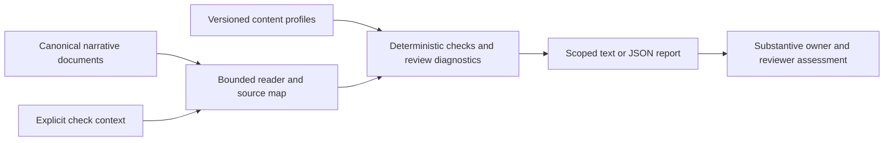

# Content-profile checker design review

Revision 0.1, 2026-11-13. Decision status: **Accepted, 2026-11-14**.
Trace: `20261113-192503-c19388`. Baseline: `fc93fbc` (PR #37).
Branch: `research/engineering-content-profile-requirements-20261113`.
Requirements: [accepted CP01-CP10](CONTENT-PROFILE-REQUIREMENTS-2026-11-13.md).
The accepted requirements remain unchanged. The owner accepted this design on
2026-11-14 without revisions. Original proposal/pending wording below is retained
as review history; the acceptance entry at the end governs continuation. The
checker's M1 subset is now implemented and merged through PR38 at `208bf72`.
The overall closeout remains decision_required for the targeted M2 amendment
below, not for the already accepted CD01-CD12. Earlier implementation-pending
statements remain historical; this current status and later entries govern.

## Boundary and actors

Authors need useful completeness feedback; reviewers need scoped findings without
false approval claims; maintainers need deterministic versioned rules and preserved
compatibility. Authors edit canonical Markdown and an explicit check-context file;
reviewers assess meaning, tailoring, evidence authenticity and actual acceptance.
The checker reads local inputs and optionally creates a new report. It never edits
the documents, native stores or approvals. There is no new role/permission system.

In scope: the accepted requirements and system-design **narrative** packs, explicit
references/tailoring, deterministic checks, contextual warnings and source-bound
reports. P02 exact-table content continues through its current validator/exporter.
It is not an input format for the new profiles in this first slice: attempting that
selection returns unsupported. A future explicit adapter may reuse its records.
This is a supported-format boundary, not a change to P02 or its valid sources.

Out of scope: automatic document/skill selection, recursive resource loading,
protocol enforcement, workbook/client projections, rendering, other document packs,
general Markdown editing, arbitrary user-defined rules and model calls.

## Structure, flow and proposed decisions



| ID | Selected design / rationale | Requirements |
| --- | --- | --- |
| CD01 | Add a separate opt-in `karakana.tools.engineering_content` module CLI/API. Do not change P02 commands/signatures or wire automatic gates in this slice. | CP01, CP10 |
| CD02 | Support `narrative-0.1`, with requirements/system-design profiles `0.1`, the accepted headings/tables and explicit selectors for tailored views. P02 sources remain independently supported by P02, not silently adapted. | CP01-CP04, CP10 |
| CD03 | Store two data-only JSON profiles in packaged `karakana/content_profiles/`, selected by registered ID/version. Validate exact keys/types and supported rule names in Python; no executable expressions, custom plugins or new schema engine. Owning engineering skills govern content changes through review. | CP01-CP05 |
| CD04 | Require a small project-local JSON check context for explicit namespace, document paths, format/profile versions, requirement baselines and exceptional coverage declarations. Select canonical content by locator rather than duplicate facts. | CP01-CP06 |
| CD05 | Use `markdown-it-py==4.3.0` via optional `content` extra and dev dependencies; parse tokens only, HTML/linkify off and tables explicitly enabled. Add strict raw-row consumption/width/header checks before trusting record tables. | CP03-CP05, CP09-CP10 |
| CD06 | Resolve applicable slots through supported local sections or declared governing views. Core content cannot be waived; conditional omissions need a located rationale and remain a reviewer decision. Unknown/multiply matched selectors fail. | CP02-CP06 |
| CD07 | Check IDs, references and declared claim/open-item fields deterministically; wording heuristics only warn. Never infer agreement, measured truth or complete semantic coverage from a phrase match. | CP03, CP06-CP08 |
| CD08 | Separate `completeness`, review warnings, unresolved acceptance items, `readiness` and `acceptance`. A mechanically complete document still requires review; no automatic ready/accepted state. | CP06-CP09 |
| CD09 | Bind each report to all read source/context/profile hashes, checker source fingerprint, parser version and rule/report versions. `verify` recomputes the assessment instead of trusting a saved passed flag. | CP09 |
| CD10 | Bound local reads; retain root/secret-path guards, raw-byte hashes and no-overwrite output. Do not fetch links, render/execute diagrams or write sources. Recheck bytes before final report publication. | CP02, CP09-CP10 |
| CD11 | Provide plain text by default and JSON on request, with stable rule IDs, source location and corrective action. Exit status describes mechanical checks only. | CP05-CP09 |
| CD12 | Verify real narrative fixtures, supported tailored references, explicit negative states, CLI/report freshness and unchanged legacy behavior. Ship one coherent checker milestone after design acceptance and its own prerequisite gate. | CP01-CP10 |

## Context, profiles and canonical authority

New contracts have independent versions `context_version`, `profile_version` and
`report_version`, initially `0.1`. They do not change P02 `CONTRACT_VERSION`, audience
profile versions, snapshots or canonical metadata. Strict JSON decoding rejects
duplicate keys, wrong types, unknown keys, unsupported versions and control characters.
No YAML aliases, interpolation or evaluation is needed for these new files.

Example minimum check context (an implementation example, not an available command):

```json
{
  "context_version": "0.1",
  "namespace": "example",
  "documents": [
    {
      "key": "req",
      "path": "skills/engineering-requirements/assets/requirements-example.md",
      "format": "narrative-0.1",
      "profile": {"id": "requirements", "version": "0.1"}
    },
    {
      "key": "design",
      "path": "skills/engineering-design-records/assets/system-design-example.md",
      "format": "narrative-0.1",
      "profile": {"id": "system-design", "version": "0.1"},
      "requirements": ["req"]
    }
  ]
}
```

Document keys are context aliases, not replacement native IDs. Actual document ID,
revision/date, product applicability and canonical source are read from the accepted
document-information table. Namespace is explicit and never inferred from repository
name. Conflicting duplicate identities/revisions or authority declarations fail.
The profile's default section/table selectors cover the accepted packs. No existing
template gains mandatory frontmatter or internal review boilerplate.

Optional context arrays are `references`, `coverage`, `omissions`, `open_items` and
`claims`; absent arrays mean empty, not implicit agreement. Each entry has a strict
typed schema. `references` declares additional local files by key/path and purpose;
they are hashed, but are not automatically followed or claimed content-complete.
If used to satisfy a profile slot, a reference must have a supported narrative
locator/content shape. An opaque machine schema can be a source reference, not a
substitute for missing design explanation.

A locator contains `document` key and exactly one explicit `anchor` or complete
`heading` path; optional `record_id` and `field` select a registered table row/cell.
No row numbers, fuzzy matching, arbitrary regex or automatic slug generation.
Inline anchors outside code are retained; unanchored accepted headings are unique
source selectors, not stable record IDs. A later rename needs a context update;
line positions are diagnostics only. Repeated headings require a unique path or
explicit anchor. All locators must resolve once to supported source content.

`coverage` maps a document/profile slot to a located local or governing view.
`omissions` maps an allowed conditional slot to a located canonical rationale;
it cannot override unconditional requirements or arbitrary rule severity.
`open_items` maps an actual source item to located affected requirements/scope,
acceptance effect, resolution role/source and next action. Existing combined
role/action prose may supply both located fields, visibly as a declaration rather
than semantic proof. Missing resolution detail is reported for correction; source
examples are not rewritten to invent decisions. `claims` selects actual observed
results or decision statements and their canonical supporting fields/evidence.
These mappings are check configuration, not a second editable copy of facts or
an approval channel. Meaning and justified scope remain review responsibilities.

The implementation validates the following data shapes, with no additional keys:

| Type | Required fields and optional additions |
| --- | --- |
| Context | `context_version`, `namespace`, `documents`; optional arrays named above |
| Document | Unique `key`, root-relative `path`, `format`, `profile` containing `id`/`version`; optional `requirements` list of declared document keys |
| Locator | `document`; exactly one `anchor` string or `heading` array of H2-and-deeper heading strings; optional `record_id` and `field` for a registered table |
| Reference | Unique `key`, root-relative `path`, `purpose`; optional supported `format` to permit located narrative coverage |
| Coverage | `document`, registered `slot`, `source` locator |
| Omission | `document`, registered conditional `slot`, `rationale` locator |
| Open item | `item` locator, nonempty `affected` list of located requirements/scopes, `effect`, `resolver` and `next_action` locators |
| Claim | `source` locator, `kind` of `test_result` or `decision`, `fields` mapping revision/actor/result/time/evidence to locators; environment locator additionally required for a test result |
| Profile | `profile_id`, `profile_version`, supported `formats`, ordered `slots`, registered `tables` and fixed `checks`; slots define selector, required/conditional and reference/omission policy; tables define supported header variants, IDs, references and required fields |

All paths are relative to the explicit root, including paths declared by context.
Located evidence URIs in a document resolve local relative paths from that source
document's directory through the same root guard. Document/reference keys share
one unique namespace; references have no profile unless promoted to a Document.
Unknown slot/table/field names and wrong locator kinds fail. Explicit context
declarations supplement default source extraction; they do not suppress detected
errors/gaps or overwrite the document's metadata. Ranges/IDs are data, not paths.

## Reader, complete consumption and profile rules

The reader uses token source maps and a retained LF parsing view; SHA-256 always
uses original bytes. Normalize CRLF only; standalone CR/BOM remain unsupported in
this first content format, matching the existing declared boundary. Record source
locations as relative path, one-based line, section and optional identity/field.
No inline cell-column precision is promised where the token parser lacks it.

Use the accepted H1/H2 content layout, optional two-digit heading prefixes and
trimmed horizontal whitespace. Fenced/indented code and quoted examples cannot
declare sections, IDs or executed results. Diagrams/code can supplement a view;
they do not alone satisfy its required explanation. HTML is not rendered/executed.

For each selected record table, check every raw candidate line and token-row source
span. Retain the existing narrow `| cell |`, exact-width, `---` separator, `&#124;`
and `<br>` convention; publish the supported header variants explicitly (for example
`Edition` versus `Edition / revision` in the accepted packs). Short/wide/unbordered
rows, unsupported escapes or unconsumed table-shaped candidates refuse the content
check. Tokens cannot silently pad/truncate data. Structural recognition and record
identity come from inspected source spans, not from a permissive rendered table.

Profiles declare slot IDs, default selectors, required/conditional disposition,
allowed reference/omission behavior, registered tables/columns and fixed check IDs.
Required requirements slots: metadata/references, purpose/scope, users/context,
affected requirement records and linked acceptance/verification. Quality/constraints
must be addressed for the affected scope; actual measures may remain unresolved.
Interfaces/data and extended stories/glossary/transition detail are conditional.
Required design slots: metadata/references, scope/requirement baseline, context,
responsibilities, relevant runtime/failure behavior, data/interfaces, security/quality,
operations, decisions and verification/gaps. A current governing view or explicit
scoped no-change explanation can satisfy unchanged coverage. UX and migration
detail are conditional. Section organization may be tailored through locators;
these are content families, not a mandatory repeated chapter layout.

Blank/header-only tables, heading-only/whitespace content and unresolved substitution
fields cannot satisfy required slots. Ignore literal substitution syntax inside
illustrative code; code-only examples cannot satisfy a required behavioral statement.
Record stable IDs from supported tables, preserving supplied IDs and namespace.
Require nonempty statements/rationale and criterion conditions/outcome/method.
Resolve declared references in both directions against the specified requirement
baseline, not all nearby documents. Narrative reference cells support exact declared
IDs, comma/semicolon-separated references and same-prefix numeric ranges used in
the accepted examples; resolve ranges against the existing declared inventory,
never allocate an unbounded numeric expansion. Retain surrounding explanatory prose. Nonstandard/ambiguous
reference syntax requires explicit source-cell/target locators in context or is
reported unsupported, never silently ignored. P02/native ID grammar is unchanged.

Rules for likely vague wording or misplaced review logistics scan only relevant
product-requirement cells/prose, with located warnings and no source-value excerpts.
No rule requires every sentence to use `shall`, bans `approval` or rejects meeting
behavior merely by word. Semantic correctness, completeness of real product needs
and omission justification remain substantive review, not regex certification.

Unresolved-item rows/gap cells and explicitly selected open items are retained in
the report. Missing effect/owner-source/action cannot become a resolved fact.
An open acceptance item marks its affected scope unresolved; it does not invent a
threshold or block unrelated work. Readiness is never inferred merely because no
open-item keyword was found: unknown/unmapped prose coverage stays visible.

Observed-result/accepted-decision claims require located revision, actor/role,
result/decision, timezone-aware observed time and evidence, plus environment for
executed tests. Proposed checks are not observations; Proposed ADRs do not require
fictional approval. Local evidence paths must exist and be hashed; external URI
evidence is not fetched or authenticated and remains an explicit evidence limit.
Plain prose cannot be exhaustively classified: likely undeclared claims warn and
the report always states that prose/evidence authenticity needs review. A missing
declared claim field fails; word detection alone does not prove or disprove a claim.

## CLI, report and UX writing

Proposed API: `check_content(root, context_path) -> ContentReport`; structured
findings carry `rule_id`, severity, location, corrective action and affected scope.
Both CLI commands call the same checker. Proposed invocations:

```text
python -m karakana.tools.engineering_content --root . check --context content-check.json
python -m karakana.tools.engineering_content --root . check --context content-check.json --format json --output checks/new-report.json
python -m karakana.tools.engineering_content --root . verify --context content-check.json --report checks/new-report.json
```

Text is the default; JSON is a stable machine view with the same facts. Optional
output is new-file only. Default output is stdout, with no hidden runtime writes.
No top-level CLI/planner/hook/protocol behavior changes. Missing optional dependency
names the supported `content` installation extra and returns a refused operation;
other Karakana/P02 commands remain usable without it.

| Report field | Meaning |
| --- | --- |
| `completeness` | `complete`, `incomplete` or `unsupported` for the stated profile/coverage; never general product correctness |
| `findings` | Stable rule ID; `error` or `warning`; location and corrective action. Unsupported input/support gaps are explicit errors, not a success with zero coverage. |
| `coverage` | Checked slots/records, referenced coverage, conditional omissions and known unassessed areas |
| `open_acceptance_items` | Located declared gaps and affected requirement/scope; missing resolution detail remains visible |
| `review_required` | Always true for substantive meaning, evidence authenticity and actual acceptance |
| `readiness` | `unresolved` for declared affected gaps, otherwise `not_assessed`; never `ready` |
| `acceptance` | `not_assessed`; source-recorded decisions are declarations with evidence limits, not checker-granted approval |
| `manifest` / `assessment_digest` | Versions, exact input hashes, checker/parser fingerprint and deterministic assessment digest, separate from actual report generation UTC |

Report `documents` contains each document's assessment with the fields above;
the top-level completeness is the worst result (`unsupported`, then `incomplete`,
then `complete`). Findings are sorted by source path/line/rule/identity for stable
comparison; input enumeration order does not change identities or the assessment
digest. Shared coverage locators are shown explicitly for reviewer assessment.

Exit 0 means supported mechanical completeness checks passed; warnings and unresolved
acceptance items may remain. Exit 2 means incomplete/unsupported input, stale or
mismatched verification, missing dependency, invalid context or refused I/O. There
is no `--strict` switch that promotes uncertain wording into authoritative failure.
The text summary always distinguishes these outcomes, for example:

```text
Content checks passed for requirements 0.1. Review is required; 2 acceptance items remain unresolved.
CP-COVERAGE-001 error docs/spec.md:24: Functional requirement coverage is missing. Add affected requirements or link the current governing view in the check context.
CP-WORDING-001 warning docs/spec.md:48: This requirement may lack an observable measure. Define the measure or record the unresolved acceptance decision.
Saved report no longer matches the checked inputs. Run the content check again for the current context.
```

UX-writing self-review: technical author/reviewer diagnostic surface; familiar
`content check`, `required coverage`, `review`, `unresolved` and `current context`
terms; text severity/location, no color-only meaning, no source-cell dump, no
unsupported fix/approval action. JSON stdout must not be mixed with text banners.

## Freshness, safety, dynamics and backfire risks

Fingerprint raw context, all declared/read sources and supporting files, selected
packaged profiles, checker implementation/helper source files, and pinned parser
version. Hash each normalized relative path/role plus exact bytes; include checker,
profile and report versions. Generation time is real UTC and excluded from the
deterministic assessment digest. Changed context, source, referenced view, profile,
checker source or parser version invalidates the old result even if a version
string or Git commit is unchanged. Re-read the inputs before returning/writing;
refuse drift. `verify` checks versions/manifest and recomputes findings/coverage,
not just a saved status/digest. Reports are observations, not signed attestations;
future enforcing consumers must recompute rather than trust author-supplied passes.

Bound inputs to 2 MB per document, 32 declared/read files and 16 MB aggregate;
context and each profile to 128 KB. These are proposed transport limits, not
measured latency/security guarantees. No automatic reference recursion; explicit
cycles in coverage/baseline links fail. Resolve roots and symlinks and reject
credential/environment/key paths using the existing read/write guards. Sources
remain immutable. No network, shell, model, HTML rendering or diagram execution.
Reports omit source snippets and unexpected exception contents. Preserve an old
report; create a new one or write stdout rather than overwrite history.

The feedback loop is author edit -> check -> reviewer correction -> recheck.
Delayed review and changed governing views can make old green reports misleading;
freshness checking and separate review/readiness fields counter that incentive.
No queue, background controller or new permission transition is needed. The useful
intervention is trustworthy scoped feedback, not extra output documents or agents.

Main backfire risks are false assurance from semantic heuristics, configuration
burden/duplicate facts, permissive Markdown table loss, stale reports and dependency
coupling. Mitigate with declared coverage limits, source locators, raw consumption,
recomputation and an optional pinned parser. A misleading omission rationale still
needs human challenge; the checker cannot certify it. No completeness percentage
or machine-ready badge is proposed.

## Alternatives, evidence and source-alignment challenge

| Alternative | Trade-off / disposition |
| --- | --- |
| Extend P02's parser and `validate` in place | Fewer commands, but couples canonical export grammar and public structural behavior to narrative profiles; reject for this bounded slice |
| Handwritten regex-only narrative parser | Avoids a dependency but recreates code-fence/table/heading semantics and risks false coverage; prefer token maps plus strict source checks |
| Convert all sources to a new universal schema or duplicate facts in a sidecar | Simplifies validation at authoring/migration cost and risks competing masters; reject |
| Manual review/templates only | Lowest code cost; retains current missing-content/staleness gaps; insufficient for accepted deterministic requirements |
| Separate narrative checker with explicit context | Selected: extra context/dependency cost, narrow compatibility and review limits; leaves routing/export changes separate |

Official parser [usage](https://markdown-it-py.readthedocs.io/en/latest/using.html),
[source maps](https://markdown-it-py.readthedocs.io/en/latest/api/markdown_it.token.html)
and [security configuration](https://markdown-it-py.readthedocs.io/en/latest/security.html)
were checked on 2026-11-13. The [current release](https://pypi.org/project/markdown-it-py/)
is 4.3.0. The local environment initially had 4.2.0, undeclared by this repository.
The 4.3.0 wheel was downloaded from official PyPI, SHA-256 checked against its
published metadata and loaded in a temporary subprocess path, without modifying
the project environment. This is a narrow API/fixture probe, not full dependency
qualification or a supply-chain certification.

| Claim challenged | Producer / consumer and contrary state | Observed / design consequence |
| --- | --- | --- |
| Tokens can safely supply record widths | MarkdownIt table source -> row/inline tokens; short and extra-cell rows | Both 4.2.0 and isolated 4.3.0 pad short rows and discard an extra cell. CD05 requires raw consumption/width guard before table-derived checks. |
| Token reading fits accepted templates and line endings | Both actual narrative examples -> token/source map with LF versus CRLF | Requirements: 9 headings, 6 tables; design: 11 headings, 6 tables. LF/CRLF signatures equal, source bytes unchanged; hash equality is not claimed. |
| Fenced examples declare real required sections | Fenced `## Functional requirements` and substitution text -> token parser | Produces a fence, no heading. CD05/CD06 exclude it from declared content and keep code-only coverage insufficient. |
| P02 already checks narrative content or profile completeness | `parse_document`/`load_bundle` -> current validate/export; accepted requirements probe and resource map | P02 refuses clean packs for missing metadata and allows valid empty/narrative structural inputs. CD01/CD02 leave these outcomes intact and declare the new support boundary. |
| Attached report or supplied evidence proves approval/readiness | Protocol `_check_artifact` checks most kinds by file presence; record validator checks supplied evidence fields | CD08/CD09 keep readiness/acceptance separate and recompute assessments; no protocol enforcement or authenticity certification is added. |
| Existing examples resolve all acceptance details | Actual Q-01/Q-02, design verification/gap cells -> proposed context/open-item mapping | Preserve the facts. Default context may need additional locators for resolution actions; missing detail remains reported, never repaired with fabricated owners/results. |

Research receipts: `/tmp/karakana-content-design-token-probe.json` and
`/tmp/karakana-content-design-markdown43.json`. Portable observations are retained
above; these temporary files are optional supporting evidence on another machine.
The accepted standards/editions in CP requirements continue to inform content;
this checker cannot assess clause-level conformity and selects no new standard.

## Bounded delivery outline and verification

After design acceptance and implementation selection, use a separate implementation
trace and prerequisite gate. Keep this branch/PR coherent with the local accepted
requirements record. Do not start another feature milestone in parallel.

1. Add versioned profile/context/report types, packaged JSON profiles and fixtures;
   test duplicate/unknown keys, unsupported versions and packaging from a built wheel.
2. Add token reader/locators, raw-table completeness and reference handling, then the
   two profiles and diagnostics. Prove negative cases before claiming rule coverage.
3. Add opt-in check/verify CLI and immutable reports, actual changed-input checks,
   dependency absence behavior and read-only local boundaries.
4. Update the shared content contract and owning/shared guides to state this exact
   opt-in narrative support and its P02/export/enforcement limits. Add neutral context
   examples under a new `content-checks/` directory, not `assets/*.md` or legacy
   `examples/*.md` collections with their established test contracts.
5. Review actual source/examples and all CP01-CP10 evidence; run focused tests then
   stable full pytest/evals and applicable skill/profile checks, diff and protocol
   completion. Refresh the handoff. Publish/squash only as separately authorised.

Implementation file map (planned, not files changed in this research task):
`karakana/tools/engineering_content.py`; `karakana/content_profiles/` with loader,
types and packaged JSON; `pyproject.toml` optional/dev dependency and package data;
`tests/test_engineering_content.py`; shared contract and owning/shared guides;
neutral `docs/skills/engineering-artifact-catalogue/content-checks/` fixtures;
this design/accepted requirements continuation. Existing parser and protocol code
need no behavior edits; their tests are compatibility controls.

Required substantive cases: both accepted narrative packs; legitimate compact
governing-view reuse; missing/empty/placeholder content; literal/fenced syntax;
short/wide/malformed neighboring rows; duplicate/missing IDs and dangling references;
missing conditional rationale/core-waiver refusal; unresolved facts with scope and
missing resolution detail; planned versus observed claims and false pass without
evidence; product approval versus authoring-logistics warnings; duplicate headings,
coverage cycles and unsupported sources/versions; LF/CRLF semantic equivalence with
different raw hashes; source/context/profile/checker/reference drift; tampered report;
path/symlink/secret/size/no-overwrite/no-partial-success; dependency isolation and
installed-wheel resource loading. Actual CLI and API must agree. No model pilot
or native Windows installation result is implied by byte-level newline coverage.

First focused gate: new content tests plus existing engineering artifact,
documentation-skill and pilot suites. Final required gates: `.venv/bin/pytest -q`,
`.venv/bin/karakana eval run` and skill validation for changed guidance; add
instruction evals only for actually changed instructions and label their limits.
Tests writing harness state use temporary repositories, never checkout runtime.
No new tests are added merely to match the wording of this design document.

Rollback for an implemented milestone is a reviewed revert/fix PR of the new
checker/resources/dependency/guidance, preserving sources and old reports. No
database migration, runtime cleanup or destructive reset is required. If full
implementation exceeds the one-milestone sizing target, split by a usable check
boundary during detailed planning rather than activate incomplete enforcement.

## Review decision, verification and continuation

Preferred proposal is CD01-CD12 as a unit, including the explicit narrative-first
boundary, context-file cost and optional pinned dependency. Owner design acceptance
is pending; requirements acceptance is already settled and must not be requested
again. Exact next action: review the design summary here, record acceptance or
revisions, then prepare the bounded implementation task. This is self-review;
no independent technical/product acceptance is claimed.

Verified this round: source/interface reconciliation; actual accepted-pack header/
token/source-map inspection; LF/CRLF and malformed/fenced contrary probes on installed
4.2.0 and isolated current 4.3.0; immutable source/environment controls. Reuse prior
140 focused compatibility tests because production/tests/templates are unchanged.
No proposed checker, new parser guard, schema, CLI, packaging or freshness behavior
has run: those are implementation acceptance cases, not delivered functionality.
Research structure/local references and whitespace are checked before handoff.

Continue this conversation for design acceptance. Recommend GPT-6 Sol high for
subsequent integrity/checker work; this is not an observed model switch or availability
claim. Current task authorises research/design only. Automatic selection/enforcement,
remaining templates/exports, pilot and Jovina stay queued. Preserve requirements
acceptance, this proposal and later revision/acceptance history.

Completion check `20261113-193837-protocol-check-c2098c` passed for trace
`20261113-192503-c19388`: artifact presence, research structure and local references
only. The separate research outcome remains `decision_required`, with
`implementation_ready: false`. Owner design acceptance is the exact next action;
the task-bound handoff preserves the self-contained proposal and evidence limits.

## Owner design acceptance — 2026-11-14

After the self-contained CD01-CD12 design summary, the owner replied
**“accepted.”** This accepts CD01-CD12 as a unit without revisions, including
narrative-first standalone checking, explicit source-selecting context, the two
versioned profiles and the optional pinned `markdown-it-py==4.3.0` dependency.
CP01-CP10 requirements acceptance remains intact. Earlier Proposed/pending
statements describe the review checkpoint; they do not reopen accepted choices.

Next recommended task: bounded implementation planning. Reuse both accepted
records and inspected evidence; name the exact files, schemas/examples, ordered
steps, meaningful test/eval cases, prerequisite gate, milestone size and rollback.
Split only if the concrete estimate exceeds the repository milestone target;
keep any split independently useful and preserve the accepted support boundary.
Do not repeat requirements or design review unless a material change arises.

Design acceptance is distinct from selecting code implementation, installing the
optional dependency into the project, PR publication/squash integration, deployment
or live model calls. Those retain their existing task authority. No production
behavior changed in this acceptance-record update. Verification: owner statement,
unchanged CP/CD scope, research structure/local references and whitespace reviewed;
prior parser probes and 140 focused compatibility tests reused, not rerun for this
history-only edit. Task-bound append-only handoff refreshed for planning.

## Implementation planning — 2026-11-14

The owner selected planning with “execute” after its task brief. The
[bounded plan](CONTENT-PROFILE-IMPLEMENTATION-PLAN-2026-11-14.md) sizes the work as
two sequential usable milestones under the split allowed above: standard-pack
checking, then advanced context/evidence/freshness verification. It records exact
files, capability/refusal boundaries, gates, real regression cases and rollback.

Planning found an omitted shape for the explicit source-cell/target mapping promised
above. The plan proposes optional `links` in context0.2, preserving0.1; this is a
targeted **proposed** amendment awaiting owner agreement before M2. It does not
silently change the accepted context0.1 contract or reopen CP01-CP10/CD01-CD12.
M1 remains independent and must refuse deferred capabilities. No code is delivered.

## M1 execution checkpoint — 2026-11-14

The owner selected local M1 implementation with “execute” after the bounded plan.
[M1 results](CONTENT-PROFILE-IMPLEMENTATION-PLAN-2026-11-14.md) record the delivered
standard-pack checker, 885 passing tests, 186 passing evals and unchanged P02/asset
baselines. Accepted CP/CD choices are preserved; this is partial local delivery,
not M2 completion or independent acceptance. Source review and separately
authorised PR/squash integration are next. No new PR/merge/deployment occurred.


## M2 reference-link amendment — revision 0.2 proposed, 2026-11-14

Review trace: `20261114-071536-43dc7e`; source baseline: merged M1 `208bf72`.
This section proposes a narrowly scoped extension of CD04/CD06/CD07/CD09/CD12.
CP01-CP10 and accepted CD01-CD12 retain their acceptance and reasoning. The owner
said **“execute”** after the amendment task brief, selecting review/documentation;
acceptance of this resulting revision is not yet recorded. No production schema
or checker behavior changes in this task. M1 integration is complete, not a blocker.

### Contract and example

Context `0.2` adds optional `links`; missing or empty means no explicit links.
Each entry has exactly `from` and `to`, each using the existing Locator contract.
All other context fields retain their accepted meanings. Context `0.1` remains
supported, with its existing keys; even empty `links` is rejected under `0.1`.
Context version does not change the narrative format or profile version. M1 keeps
rejecting `0.2`; M2 implements this contract only after the decision/task gates.

The following is a proposed context fragment, not a runnable M1 context or new
source of truth. Two entries demonstrate multiple targets for the actual example's
REQ-01 acceptance cell; existing reverse references remain independently checked.

```json
{
  "context_version": "0.2",
  "links": [
    {
      "from": {"document": "req", "heading": ["Functional requirements"], "record_id": "REQ-01", "field": "Acceptance criteria"},
      "to": {"document": "req", "heading": ["Acceptance and verification"], "record_id": "AC-01"}
    },
    {
      "from": {"document": "req", "heading": ["Functional requirements"], "record_id": "REQ-01", "field": "Acceptance criteria"},
      "to": {"document": "req", "heading": ["Acceptance and verification"], "record_id": "AC-02"}
    }
  ]
}
```

`from` must include `field` and resolve exactly once to a nonempty registered
reference-bearing cell in a declared profiled Document. A section or whole row
alone is not a source cell. For an identified row, use its actual `record_id`.
For a row without an identity, use an existing explicit anchor that locates that
row/cell uniquely, plus the field. An anchor on the containing multirow section
is insufficient. A heading path plus field is usable only when it selects exactly
one cell. Do not add row-number/fuzzy selectors or infer IDs from cell prose.
Missing unique source anchors require author correction; the checker never edits
sources to insert them. M2's reader must retain actual anchor-to-row/cell positions.

`to` must include `record_id`, omit `field`, and resolve exactly once to an actual
record of the required kind in the selected baseline. No new native IDs are
created. Requirements cells resolve within the owning requirements document;
design cells resolve only within their explicitly declared requirements documents.
File-only `references`, arbitrary prose and unprofiled evidence files cannot supply
target record inventories. Existing duplicate identity/baseline checks still apply.

| Registered source cell | Permitted target record |
| --- | --- |
| Requirements functional `Acceptance criteria` or quality `Verification reference` | Criterion in the owning requirements document |
| Requirements acceptance `Requirement ID` | Functional/quality requirement in the owning requirements document |
| Design quality `Requirement / concern` or verification `Requirement / risk` | Requirement in a declared requirements baseline |
| Design quality `Verification reference / unresolved measure` or verification `Planned check / evidence` | Criterion in a declared requirements baseline |

An edge denotes the declaration for its entire source cell, not a token offset.
Group entries by the resolved source cell; different target records are allowed.
If canonical target IDs/ranges occur, their resolved target set must equal that
cell's explicit target set. A matching set corroborates the existing references;
it does not add duplicate graph edges. An additional or missing explicit target
is a conflict. Invalid/dangling canonical IDs and malformed ranges remain errors,
including when a valid explicit edge exists. For a nonempty custom-reference cell
with no canonical target IDs, explicit entries declare its complete target set;
without entries it remains unsupported. Do not claim that parsing proves the
mapping matches every phrase: content meaning still requires substantive review.
Q/unknown references retain their independent unresolved effects and never become
criterion/requirement edges through this array. Forward/reverse requirement-to-
criterion consistency and design coverage are checked on the resolved graph.

Reject duplicate explicit edges after resolving locators, including different
heading/anchor selectors for the same endpoints; reject unknown keys/fields,
wrong kinds/baselines, absent/ambiguous selectors and conflicting mappings. A
canonical reference matching one explicit edge is corroboration, not a duplicate
input entry. Locator/source changes invalidate a saved report's raw manifest;
reordering the same links may preserve its assessment digest but not byte freshness.
Keep existing source guards, bounded reads, immutable output and no-network rules.
Do not introduce rule/severity overrides or automatic ready/accepted states.

### Rationale, alternatives and consequences

A separate versioned edge array implements the already accepted disambiguation
operation without changing `coverage` (profile-slot coverage) or `references`
(file registration). It reuses actual source records and preserves version0.1.
The cost is strict locator resolution, per-field typing and graph reconciliation;
author-supplied anchors may be necessary for previously unidentifiable cells.
Assumption: authors can provide explicit configuration and unique source anchors;
when they cannot, report unsupported/ambiguous rather than guess.

Keeping the current schema and unsupported syntax is a feasible smaller alternative,
but leaves the promised custom-reference disambiguation unavailable. Overloading
coverage avoids a new top-level field but changes its meaning and still fails to
represent two endpoints clearly. A token expression language is unnecessary scope.

### Source-alignment challenge and acceptance cases

| Claim | Producer -> consumer and contrary state | Observed evidence / required M2 result |
| --- | --- | --- |
| Existing schema supports explicit edges | `schemas.validate_context` -> current checker; either0.2 or `links` supplied | M1 rejects both; retain refusal until M2 actually delivers it. |
| All rows already have selectable identities | Packaged design quality/verification tables -> reader/locator consumer; tables declare empty identity | Observed no stable row ID; require a unique actual anchor/cell selection, never manufacture an ID or select the first row. |
| A mapping cannot hide a bad source reference | `checks.references` -> forward/reverse graph; AC-99 plus a valid explicit target | Existing parser reports dangling ID; proposed M2 must retain that error and enforce equal canonical/mapped sets. |
| A target of the wrong type can satisfy coverage | Profile/declared Document inventory -> edge resolver; criterion supplied for a requirement cell | Reject wrong type/document; identical-looking IDs cannot bypass declared baseline or duplicate-identity checks. |
| Explicit references resolve semantic truth | Source prose + context -> mechanically resolved graph; misleading custom text still points to a real row | Report located declarations and require review; no authenticity, readiness or approval claim. |
| Equivalent link order proves report freshness | Context bytes -> raw manifest and semantic digest -> verify | Recompute both; semantic equality alone cannot establish freshness. |

M2 regression cases must include: absent/empty links under0.2; links under0.1;
unknown versions/keys; one-to-many and reverse consistency; missing/ambiguous cells;
row/cell anchors and alias-selector duplicates; wrong-kind/out-of-baseline targets;
custom prose without mappings; complete mapped custom targets; canonical matching,
extra/missing/conflicting targets and dangling IDs despite mappings; unresolved Q
preservation; link-order byte changes and target-source drift. These are planned
cases, not tests implemented or passed by this documentation task.

Standards use remains the accepted tailored guidance in CP's Standards and references:
ISO/IEC/IEEE29148:2018 for traceable requirements/verification,42010:2022 for relevant
architecture concerns/views,ISO/IEC25010:2023 for applicable quality concerns and
ISO/IEC/IEEE15289:2019 for information-item content. No new edition or clause-level
conformity claim is introduced; no external standard text was newly researched.

### Exact decision and readiness

Preferred choice: accept this context0.2 links contract. Decision owner: project
owner. Alternative decision: retain unsupported explicit mappings. Safe completed
work is this source-grounded review, schema/example and plan clarification. Held
work is activation/implementation of M2; owner agreement on this revision and
selection of M2 are still required. `research_outcome: decision_required` and
`implementation_ready: false` until that scoped decision is recorded. The blocker
is exactly amendment acceptance, not M1 integration or a broad architecture restart.
Record agreement or revisions here and in the existing plan, preserving history;
then run M2's own prerequisite gate before code. No additional approval for the
already completed M1 integration is outstanding.


## Owner amendment acceptance — 2026-11-14

The owner replied **“accepted”** after the completed amendment review summary.
This accepts design revision0.2's context0.2 `links` contract without revisions:
unique source cells, one-to-many target sets, registered target types/baselines,
anchors for non-ID rows, canonical-reference reconciliation and context0.1
compatibility. The original CP01-CP10/CD01-CD12 acceptance and tailored standards
remain intact. Earlier proposed/pending/readiness-false entries are review history;
this scoped acceptance supersedes them for the amendment decision.

Acceptance trace: `20261114-072153-949637`. Research outcome is now
`ready_for_implementation` for the resolved design/plan, with no material amendment
decision outstanding. This readiness does not execute M2 or claim that its code,
new tests or verification are delivered. The owner's standing clarification that
accepted work includes its normal validated PR/squash integration is applied to
this completed documentation slice. Complete that integration, then present the
M2 implementation brief; deployment and live model calls remain separate.

Only acceptance/continuation metadata and this history entry changed after the
reviewed proposal. Reuse its66 passing content tests and source-backed review;
validate current YAML/JSON/links, diff scope and acceptance consistency before
integration. Do not repeat the already accepted requirements/design review or ask
again for M1 integration or this amendment's acceptance.
