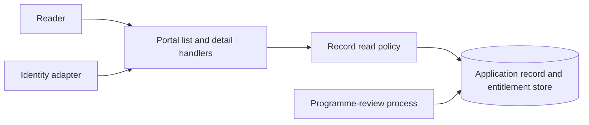

# Programme record portal — system design

| Document information | Value |
| --- | --- |
| Document ID | EX-DES |
| Revision | 0.1 |
| Date | 2026-11-13 |
| Product / release applicability | Synthetic programme record portal; no real product release |
| Canonical source / baseline | This worked example, revision 0.1 |

## Standards and references

This synthetic design uses a tailored approach informed by
ISO/IEC/IEEE 42010:2022. Quality concerns use ISO/IEC 25010:2023 as a reference;
documentation content is tailored with reference to ISO/IEC/IEEE 15289:2019.
No conformity assessment was performed.

| Reference | Edition / revision | Application |
| --- | --- | --- |
| [Architecture description](https://www.iso.org/standard/74393.html) | ISO/IEC/IEEE 42010:2022 | Architecture-description concerns and views |
| [Product quality model](https://www.iso.org/standard/78176.html) | ISO/IEC 25010:2023 | Relevant quality concerns |
| [Documentation content](https://www.iso.org/standard/74909.html) | ISO/IEC/IEEE 15289:2019 | Tailored document content |
| [Requirements](../../engineering-requirements/assets/requirements-example.md) | EX-REQ 0.1 | REQ-01–REQ-06 and AC-01–AC-06 |
| [C4](https://c4model.com/diagrams) / [arc42](https://arc42.org/overview/) | Guidance consulted 2026-11-13 | Diagram depth / architecture content selection |

## Purpose and scope

The proposed design supports list and detail reading of approved programme
records according to EX-REQ 0.1. It addresses REQ-01–REQ-06. Record submission,
approval execution, exports, attachments and identity provisioning remain outside
this example. No application or deployment has been implemented.

## System context

Readers need access to permitted records; programme administrators maintain
assignments; the external programme-review process supplies record approval state.
The portal trusts an identity adapter for authenticated subject identity while
using current application data for record permission and programme assignment.

This context/component sketch shows the application boundary and dependencies.
It omits internal deployment topology, which is unresolved. The Mermaid source
above is the editable source of this view.

## Solution structure

| Element | Responsibility | Interfaces / dependencies |
| --- | --- | --- |
| List/detail handlers | Obtain subject identity, invoke read policy and return permitted content | Identity adapter and record read policy |
| Record read policy | Check current read permission and programme assignment; require approved record state | Application store; used by both handlers |
| Application store | Own programme assignments, permissions, records and their current approval state | Authoritative transactional reads; approval changes from the external process |
| Response boundary | Return permitted content or a sanitised denial/failure | Handlers; final identity/error mapping depends on Q-02 |

## Runtime behavior

1. The handler obtains the subject identity. Missing identity denies reading.
2. The policy reads the subject's current permission and programme assignments
   from the authoritative application store for this request.
3. List retrieval scopes records by permitted programme and approved state.
   Direct retrieval checks the requested record against the same rules.
4. The response boundary returns permitted content. Missing permission/scope,
   pending approval or dependency failure prevents record disclosure.

After an assignment removal commits, the next request reads the changed
application state; session identity does not cache programme entitlements. This
addresses REQ-03 without promising cancellation of an already running request.
An unavailable assignment/permission store denies reading; failure recovery is a
later request after the dependency becomes available, with all checks repeated.

## Data and interfaces

The application owns subject-to-programme assignments and read permissions. Each
record has a stable ID, programme ID and approval state supplied by the review
process. Both handlers consume a shared policy result containing permitted scope
or a denial; they do not expose the policy's restricted details to readers.

The actual identity adapter, API/schema versions and error mapping remain Q-02
in EX-REQ. No executable schema is provided by this example. Any real interface
definition remains authoritative in its owning source; the deployment must also
define how external approval updates become committed application state.

## Security and quality

| Requirement / concern | Design response | Verification reference / unresolved measure |
| --- | --- | --- |
| REQ-01, REQ-02 | Shared server-side scope/approval policy on both handlers | AC-01–AC-03 integration matrix |
| REQ-03 | Current authoritative assignment read for each new request | AC-04 sequential revocation case |
| REQ-04, REQ-05 | Deny reading on unresolved policy and sanitise responses/diagnostics | AC-02 and AC-05 failure/disclosure checks |
| REQ-06 | Measure list response after workload/environment are selected | AC-06; Q-01 remains unresolved, no latency result claimed |

## Deployment and operations

The proposed deployment has a web application, its authoritative transactional
store and the selected identity adapter. Specific host topology, transport trust,
service limits, backups, restore steps and monitoring destinations require actual
target decisions. These must be established before operational qualification.
The logical read-policy design alone does not demonstrate target readiness.

## Decisions and trade-offs

| Decision | Rationale / alternatives | Consequences | ADR / source |
| --- | --- | --- | --- |
| ADR-01: shared server-side policy with current entitlements; Proposed | UI-only filtering cannot cover direct requests. Session-cached assignments reduce reads but conflict with REQ-03 without an agreed invalidation mechanism. | Consistent checks and next-request revocation; extra reads and a store dependency. Missing policy data denies reading. | Decision rationale in this section; EX-REQ REQ-01–REQ-05 |

The example retains the full rationale here because it is one compact choice.
A real consequential change can link a separate ADR under the project convention.
No actual architecture decision-owner approval is recorded by this example.

## Verification and unresolved matters

| Requirement / risk | Design coverage | Planned check / evidence | Remaining gap |
| --- | --- | --- | --- |
| REQ-01, REQ-05 | Policy and response boundary | AC-01, AC-02 permission/scope and disclosure cases | Actual handler paths and responses are not implemented |
| REQ-02 | Approved-state condition | AC-03 pending/approved boundary cases | External review-state update contract needs actual definition |
| REQ-03 | Current assignment read per request | AC-04 removal committed before next request | No test run exists |
| REQ-04, REQ-05 | Policy-failure denial | AC-05 dependency-failure and diagnostic inspection | Actual adapter/error contract Q-02 |
| REQ-06 | Proposed measured list check | AC-06 after Q-01 resolution | Percentile/target, workload and environment unresolved |

All checks are planned. No test results, recovery proof or operational acceptance
are claimed; Q-01/Q-02 and deployment decisions remain explicit limitations.
